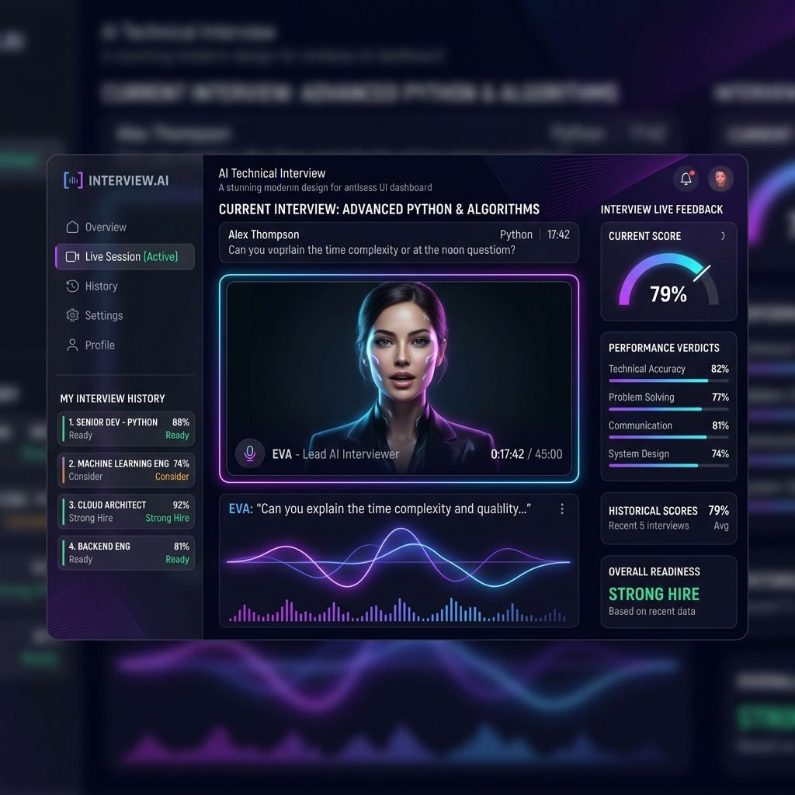

# AI Technical Interviewer

An intelligent, full-stack application that conducts realistic, voice-based technical mock interviews. Powered by Llama 3 (via Groq) and OpenAI's Whisper (via Groq), this platform acts as an AI hiring manager that evaluates your answers in real-time, adapts its follow-up questions to your experience level, and provides comprehensive feedback.

<p align="center">
  
</p>

## ✨ Features

- **Dynamic Voice Interviews**: Talk to the AI through your microphone; hear its questions spoken out loud using browser Text-to-Speech (TTS).
- **Adaptive Questioning**: The AI dynamically adjusts its questions based on your previous answers, testing limits without overwhelming you.
- **Role & Level Calibration**: Interviews are tailored specifically for various roles (Frontend, Backend, DevOps, etc.) and seniorities (Intern to Staff).
- **Resume Integration**: Upload your resume and a target job description so the AI can drill down into your actual past projects.
- **Real-Time Evaluation**: Answers are scored from 1-100 on the fly, with immediate, constructive feedback.
- **Comprehensive Final Report**: Receive a readiness verdict, overall score, key strengths, actionable improvements, and a breakdown across 5 skill categories.

## 🛠️ Tech Stack

### Backend
- **Framework**: FastAPI (Python)
- **Database**: SQLite with SQLAlchemy ORM
- **Migrations**: Alembic
- **AI Integration**: Groq API (Llama 3 70B for reasoning, Whisper Large V3 for transcription)

### Frontend
- **Framework**: React (Vite)
- **Routing**: React Router v6
- **Styling**: Vanilla CSS with modern glassmorphism UI
- **Icons**: Lucide React
- **Audio/Speech**: Web Audio API (visualizers) & SpeechSynthesis API (TTS)

## 🚀 Getting Started

### Prerequisites
- Node.js (v18+)
- Python 3.10+
- A valid [Groq API Key](https://console.groq.com/)

### 1. Backend Setup

1. Open a terminal and navigate to the project root:
   ```bash
   cd ai-interview-api
   ```
2. Create and activate a virtual environment:
   ```bash
   python -m venv venv
   # On Windows:
   .\venv\Scripts\activate
   # On macOS/Linux:
   source venv/bin/activate
   ```
3. Install dependencies:
   ```bash
   pip install -r requirements.txt
   ```
4. Configure Environment Variables:
   Create a `.env` file in the root directory:
   ```env
   GROQ_API_KEY=your_groq_api_key_here
   DATABASE_URL=sqlite:///./test.db
   SECRET_KEY=your_random_secret_string
   ALGORITHM=HS256
   ACCESS_TOKEN_EXPIRE_MINUTES=1440
   ```
5. Run Database Migrations:
   ```bash
   alembic upgrade head
   ```
6. Start the Backend Server:
   ```bash
   uvicorn app.main:app --reload
   ```
   The API will be available at `http://127.0.0.1:8000`.

### 2. Frontend Setup

1. Open a new terminal and navigate to the frontend directory:
   ```bash
   cd ai-interview-api/frontend
   ```
2. Install dependencies:
   ```bash
   npm install
   ```
3. Start the Development Server:
   ```bash
   npm run dev
   ```
   The application will be available at `http://localhost:5173`.

## 📂 Project Structure

```text
ai-interview-api/
├── alembic/                # Database migrations
├── app/                    # FastAPI Backend
│   ├── routers/            # API endpoints (auth, interviews)
│   ├── services/           # AI & STT integration logic
│   ├── models.py           # SQLAlchemy database models
│   ├── schemas.py          # Pydantic data validation models
│   └── main.py             # FastAPI entry point
├── frontend/               # React Frontend
│   ├── src/
│   │   ├── components/     # UI components (Dashboard, Setup)
│   │   ├── pages/          # Full page views (LiveInterview, Report)
│   │   └── services/       # Axios API client
│   └── index.html          
├── .env                    # Environment variables
└── alembic.ini             # Alembic configuration
```

## 📝 License

This project is licensed under the MIT License.
